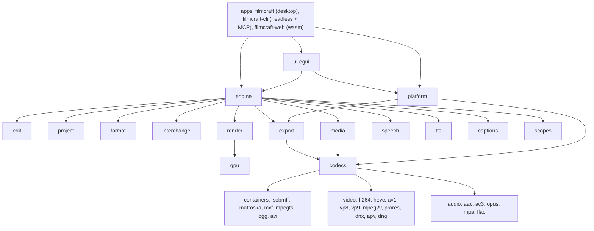

# Code map (our fork)

What each part of the tree owns, how the parts connect, and what is platform-specific. Upstream's detail lives in its own docs (`docs/architecture*`, `AGENTS.md`); this map is ours, for sizing and placing issues. Read from the tree on 2026-10-28: a Cargo workspace of `crates/*`, `apps/*` and `xtask` (52 crates, 3 apps and xtask; `main` is the integration branch).

Describes commit: 81a33e72 (2026-10-28)

Upstream owns everything not named under "Where our delta lives" and "Ours only" below. Against upstream `main` our branch adds mostly `crates/interchange` (the Premiere importer), `crates/craft-log` and `crates/craft-stage`, `crates/engine` (relink, live link, save recovery), `crates/platform` (VA-API, NVENC), the self-logging and `window_fit` code in `apps/filmcraft`, and `docs/premiere-fx-projects.md`. The upstream-sync pull request that is open at this commit is not mapped here.

## Layers

## Parts

| Part | Crates | Owns | Platform notes |
|---|---|---|---|
| Apps | `apps/filmcraft`, `apps/filmcraft-cli`, `apps/filmcraft-web` | Desktop entry point; headless CLI with the command surface (`commands`, `exec`, `run`, `render`, `export`) and MCP server; browser build | Windows: `--version` / `--help` print to the terminal (ours). Wayland window fit lives here (ours, `apps/filmcraft/src/window_fit.rs`). Self-logging hooks (`self_logging*.rs`, ours). Web: WebGPU/WebGL2, WebCodecs |
| UI | `ui-egui` | Panels, docking, timeline, monitors, control channel (`--control`) | Wayland drag and drop broken (#55); system fonts and file dialogs differ per OS |
| Engine | `engine`, `automation` | Session, command registry, undo history, media pool; relink and offline slate (`relink.rs`, ours); live link to EffectCraft (`live_link.rs`, ours); presets; MCP over the engine | all |
| Document | `project`, `format`, `edit`, `time`, `geom`, `color` | Document model (bins, clips, sequences, tracks, effects, keyframes, markers); `.fcproj` files with migrations, atomic saves and auto-save rotation; pure edit algebra; time and geometry maths | atomic save and junction cases differ on Windows |
| Interchange | `interchange`, `cfb` | EDL, ALE, FCP7 XML, FCPXML, OTIO, OMF, AAF (via `cfb`); Premiere `.prproj` and `.prfpset` import in `interchange/src/premiere/` (project, effects, presets, text, legacy titles; carried from another contributor's upstream PR). Import only: writing `.prproj` is not built (#57). Relink itself is in `engine` | relink across Windows / Mac / Linux paths (#40) |
| Render | `render`, `gpu`, `golden` | Sequence evaluation and CPU reference compositor; wgpu compositor; golden-image and GPU-vs-CPU tests | GPU backends: Metal, DX12/Vulkan, Vulkan (RADV on our AMD handheld); GPU tests are serialized |
| Media and codecs | `media`, `codecs`, `frame`, `bitstream`, containers, video and audio codec crates | Probing, decoding traits, frame cache; container and codec hub; clean-room pure-Rust codecs | pure Rust: same on every OS |
| Hardware | `platform` | OS codecs, registered into `codecs` and `export`; fallback to pure Rust. The one crate allowed `unsafe` (`deny` instead of the workspace's `forbid`; FFI modules only, see `docs/adr/0001-platform-ffi.md`) | **platform-specific throughout**: macOS is VideoToolbox (decode and encode); Windows is Media Foundation / DXVA decode plus NVENC; 64-bit Linux is VA-API and NVDEC decode plus NVENC. NVDEC and NVENC need an NVIDIA GPU and driver, and their tests run only on the NVIDIA PC. VA-API on Mesa radeonsi is our AMD work (D1). No hardware path on other systems: pure-Rust decoders take over |
| Export | `export`, `h264enc` | Render, encode, mux; presets; progress and cancel; hardware-or-software encoder choice (`encoder_decision.rs`, ours); never silently overwrites (D6) | hardware encoders via `platform` (NVENC on NVIDIA only) |
| Audio, text, speech | `audio-dsp`, `text`, `captions`, `speech`, `tts`, `tts-text`, `scopes` | Loudness and audio effects; fonts, shaping, layout; captions import/export and burn-in; Whisper speech to text; text to speech; video scopes | system fonts differ per OS (Korean needs an installed font) |
| Ours only | `craft-log`, `craft-stage` | Self-logging (log files, secret masking, crash and stall reports) and named stages (D5); wired in by `engine` and the apps | Windows diagnostics gaps (#64) |
| Tooling | `xtask`, `testkit` | Build tasks (`cargo xtask ci` is the test gate); test helpers (ffmpeg oracle, fixtures) | — |

## CI

Workflows are upstream's (`.github/workflows/`): `ci.yml` (the test gate, a reusable workflow from `storytold/craft-common-actions`, on push to `main`, pull requests and manual runs), `sonarcloud.yml`, `nix.yml`, `packaging-lint.yml` (push to `main` and pull requests), `windows-arm64.yml` and `freebsd.yml` (pull requests, release pushes and scheduled runs), and `release.yml` (pushes to `release`). The test gate was re-enabled on our fork on 2026-10-28 and runs on GitHub's runners, but its first runs fail early (the formatting check) and it has never gone green here; #77 asks for our own cross-platform `cargo test` job beside it. The gate runs on Linux only; there are no Windows or macOS test jobs on our fork yet.

## Where our delta lives

D1 `crates/platform/src/vaapi` (VA-API), `crates/codecs` (open-GOP seek, `gop.rs`, `mp4.rs`), `crates/gpu`, `crates/render` · D2 `crates/interchange/src/premiere` (Premiere import), `crates/engine/src/relink.rs` (relink, offline slate) · D3 not built · D4 `crates/engine/src/live_link.rs`, `crates/ui-egui` (Settings, Edit Original) · D5 `crates/craft-log`, `crates/craft-stage`, `self_logging*.rs` in both apps · D6 `crates/format` (atomic save, auto-save), `crates/engine` (save recovery), `crates/export` · D7 `apps/filmcraft/src/window_fit.rs`, `crates/ui-egui` · D8 not built · D9 `crates/h264enc`, `crates/testkit` (fixtures; the private-corpus ratchet is not in the tree).
