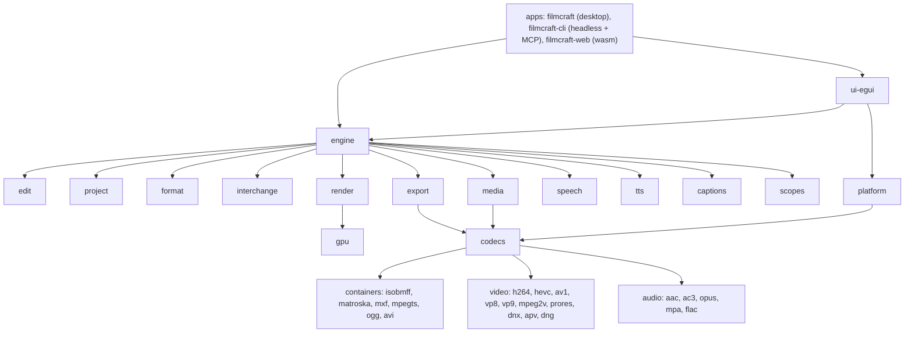

# Code map (our fork)

What each part of the tree owns, how the parts connect, and what is platform-specific. Upstream's detail lives in its own docs (`docs/architecture*`, `AGENTS.md`); this map is ours, for sizing and placing issues. A file-level map (one page per source file, which issue bodies cite as `crates__<crate>__src__<file>.md`) is kept in the owner's private pipeline repo. Read from the tree on 2026-10-26: a Cargo workspace of `crates/*`, `apps/*` and `xtask` (about 50 crates).

## Layers

## Parts

| Part | Crates | Owns | Platform notes |
|---|---|---|---|
| Apps | `apps/filmcraft`, `apps/filmcraft-cli`, `apps/filmcraft-web` | Desktop entry point; headless CLI with the command surface (`commands`, `exec`, `run`, `render`, `export`) and MCP server; browser build | Windows: `--version` / `--help` print to the terminal (ours). Web: WebGPU/WebGL2, WebCodecs |
| UI | `ui-egui` | Panels, docking, timeline, monitors, control channel (`--control`) | Wayland window fit (ours, `window_fit`); Wayland drag and drop broken (#55) |
| Engine | `engine`, `automation` | Session, command registry, undo history, media pool; MCP over the engine | all |
| Document | `project`, `format`, `edit`, `time`, `geom`, `color` | Document model (bins, clips, sequences, tracks, effects, keyframes, markers); `.fcproj` files with migrations, atomic saves and auto-save rotation; pure edit algebra; time and geometry maths | atomic save and junction cases differ on Windows |
| Interchange | `interchange`, `cfb` | EDL, FCP7 XML, FCPXML, OTIO, AAF (via `cfb`); our Premiere `.prproj` importer and relink | relink across Windows / Mac / Linux paths (#40) |
| Render | `render`, `gpu`, `golden` | Sequence evaluation and CPU reference compositor; wgpu compositor; golden-image and GPU-vs-CPU tests | GPU backends: Metal, DX12/Vulkan, Vulkan (RADV on our AMD handheld) |
| Media and codecs | `media`, `codecs`, `frame`, `bitstream`, containers, video and audio codec crates | Probing, decoding traits, frame cache; container and codec hub; clean-room pure-Rust codecs | pure Rust: same on every OS |
| Hardware | `platform` | OS codecs: VideoToolbox (macOS), Media Foundation (Windows), VA-API and NVDEC (Linux), NVENC export; fallback to pure Rust. The one crate allowed `unsafe` | **platform-specific throughout**: VA-API on Mesa radeonsi is our AMD work (D1); NVENC tests run only on the NVIDIA PC |
| Export | `export`, `h264enc` | Render, encode, mux; presets; progress and cancel | hardware encoders via `platform` |
| Audio, text, speech | `audio-dsp`, `text`, `captions`, `speech`, `tts`, `tts-text`, `scopes` | Loudness and audio effects; fonts, shaping, layout; captions import/export and burn-in; Whisper speech to text; text to speech; video scopes | system fonts differ per OS (Korean needs an installed font) |
| Ours only | `craft-log`, `craft-stage` | Self-logging and named stages (D5) | Windows diagnostics gaps (#64) |
| Tooling | `xtask`, `testkit` | Build tasks; test helpers (ffmpeg oracle, fixtures) | — |

## CI

Workflows are upstream's (`.github/workflows/`): `ci.yml` (the test gate, a reusable workflow from `storytold/craft-common-actions`), `windows-arm64.yml`, `nix.yml`, `freebsd.yml`, `packaging-lint.yml`, `sonarcloud.yml`, `release.yml`. On our fork the test gate has never run (see its issue); the other workflows run on push and pull requests.

## Where our delta lives

D1 `crates/platform` (VA-API), `crates/gpu`, `crates/render` · D2 `crates/interchange` (Premiere import, relink), `crates/engine` (relink commands) · D4 `crates/engine` (live link), `crates/ui-egui` (Settings, Edit Original) · D5 `crates/craft-log`, `crates/craft-stage` · D6 `crates/format`, `crates/export` · D7 `crates/ui-egui`.
